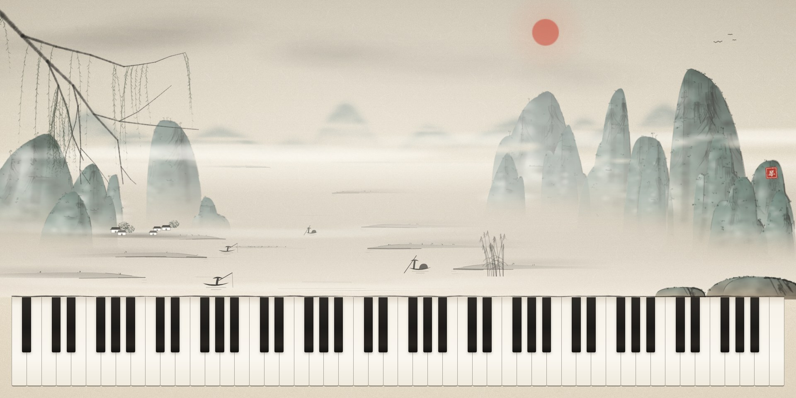
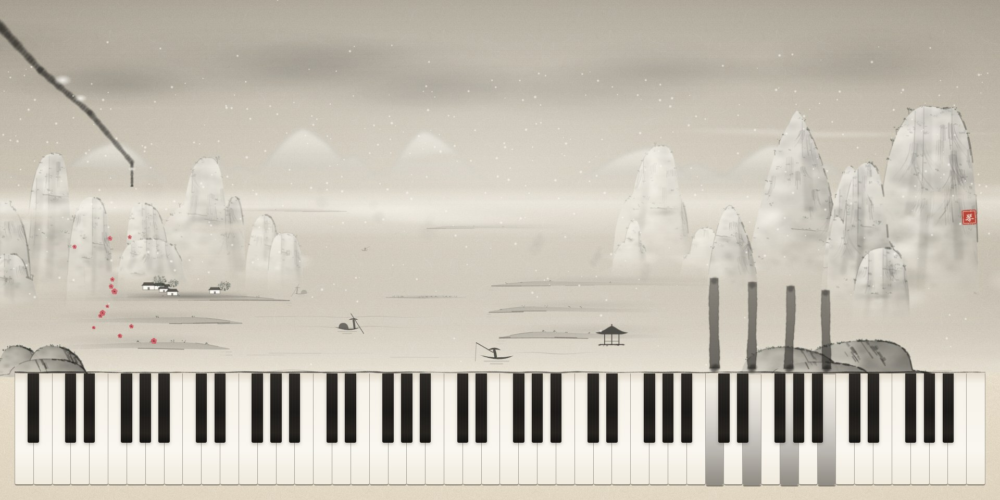
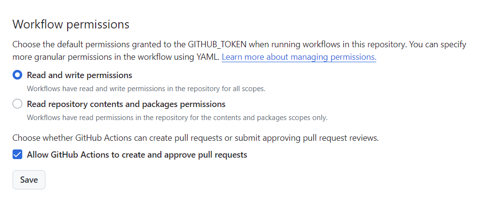

# PianoWeb
An 88-key piano in the browser that paints as you play. Behind the keys is a Chinese ink-wash landscape (山水画) that listens to the music and keeps repainting itself, so no two performances leave the same picture.

## Demo
[https://lyuanzhi.github.io/PianoWeb](https://lyuanzhi.github.io/PianoWeb)



## How to Play
- **Mouse**: click a key, or hold the button and drag across the keys for a glissando.
- **Touch**: tap the keys on a phone or tablet.
- **Computer keyboard**: four rows of keys play the white keys from C1 to B6, low to high.

| Keys | Notes |
| --- | --- |
| `1` `2` … `0` `-` `=` | C1 – G2 |
| `Q` `W` … `P` `[` `]` | A2 – E4 |
| `A` `S` … `L` `;` `'` | F4 – B5 |
| `Z` `X` … `M` | C6 – B6 |

Black keys are played with the mouse or by touch. Browsers only allow sound after the first click, tap or key press, so the first note also switches the sound on.

## The Painting
- **Every note is a brush stroke.** It grows out of its key while the key is held. Once the key is released, it floats up and dissolves like ink dropped in water.
- **The harmony chooses the season.** Bright, major, high music brings spring and summer. Dark, minor, low music brings autumn and winter. Each season has its own colours, sky, plants and birds, and its own petals, leaves or snow drifting down.
- **The energy chooses the weather.** Quiet playing gives still mist, a sun or moon, and birds overhead. Dense, loud playing with big chords and leaps gathers a storm: clouds darken, rain falls, and hammered chords strike lightning, most often in summer.
- **Where you play decides what is painted.** High notes add branches, blossoms and birds. Low notes add plants on the water. The middle of the keyboard repaints the peaks and the shore.
- **The landscape is laid out like a painting.** A river winds into the distance, with tall peaks on one bank, a village on the other, and far ranges fading into the haze. Peaks are drawn the traditional way: outline, texture strokes, rubbed shadows, moss dots and washes of colour.
- **Fishing boats** cross the river all the time, whatever the music is doing.
- **Nothing repeats.** Every peak, tree and cloud is generated when it is painted, and the composition changes on every visit.



## Tech Stack
1. Vue 2 (Vue CLI 3)
2. Canvas 2D for all the painting, without any drawing library
3. Web Audio API for the sound

| File | What it does |
| --- | --- |
| `src/views/Piano.vue` | The keyboard, mouse, touch and key input, the note strokes, and the frame loop |
| `src/views/inkScene.js` | The composition, the mood and seasons, the weather, and everything that moves |
| `src/views/inkPainters.js` | Painters for each kind of element: peaks, shores, the village, plants, mist, rain |
| `src/views/ink.js` | Rice paper texture, ink sprites and colour helpers |
| `src/views/pianoSound.js` | Sample playback. Every third key has its own recording, and the keys between borrow the nearest one, shifted by a semitone |

The scenery is drawn on separate canvases: the sky, the land, the mist, and the strokes in front. The land is redrawn only when something on it changes. Painting a peak takes several milliseconds, so the big paintings are spread over frames, a few milliseconds at a time, and the animation stays smooth while you play.

## Dependencies
```
Node.js: 14.x
./package.json
```

## Node.js Run and Build
1. ```npm install```
2. ```npm run serve```
3. ```npm run build```

On Node.js 17 or newer, webpack 4 needs the legacy OpenSSL provider, so set it before running `serve` or `build`:
```
export NODE_OPTIONS=--openssl-legacy-provider          # bash
$env:NODE_OPTIONS = "--openssl-legacy-provider"         # PowerShell
```

`package-lock.json` is not committed: a lockfile written by a newer npm cannot be read by the npm 6 that ships with Node.js 14 in the deploy workflow.

## Deploy
Just follow the instructions in ```./.github/workflows```.

### Two Things To Note
1. You should give the workflow permission to create a new branch.


2. You should add ```vue.config.js``` which configures the ```publicPath```.
```
module.exports = {
  publicPath: '/PianoWeb/'
}
```
